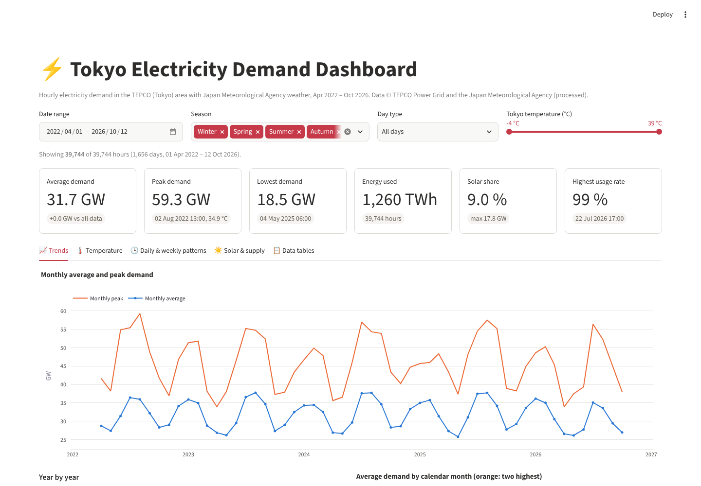
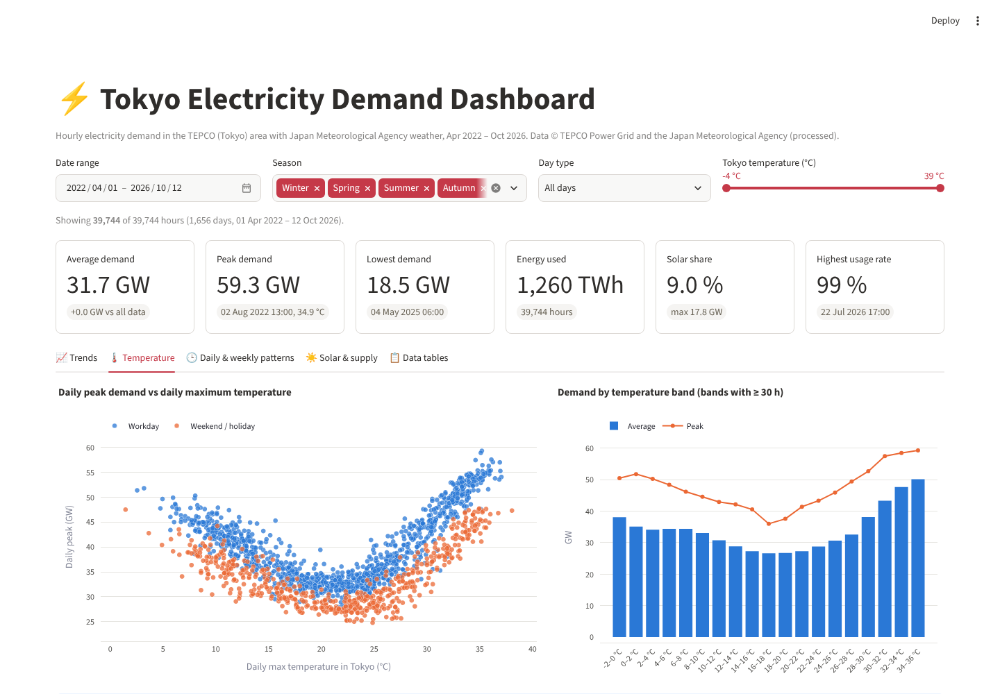
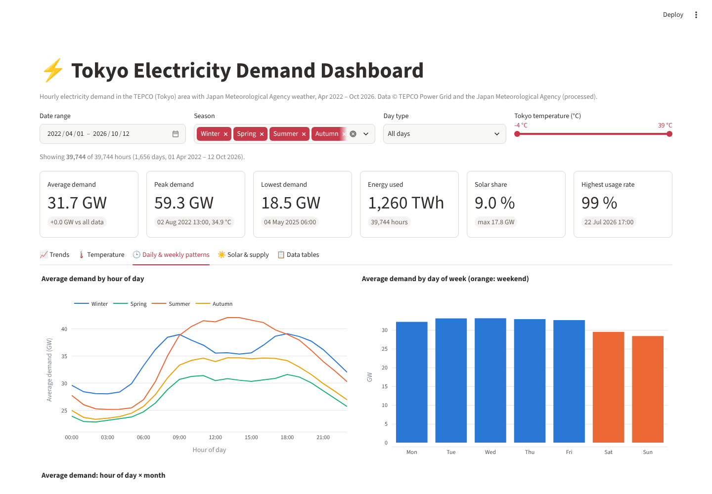
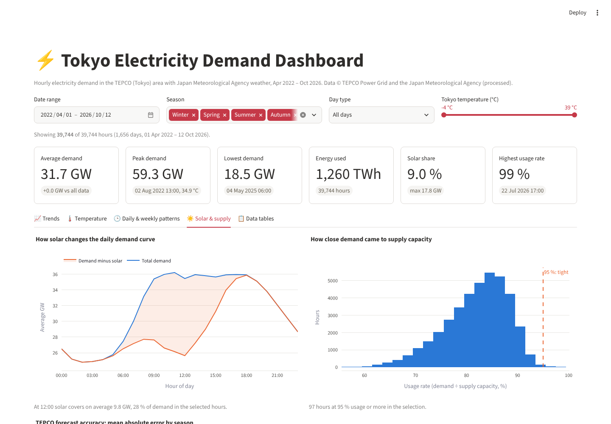
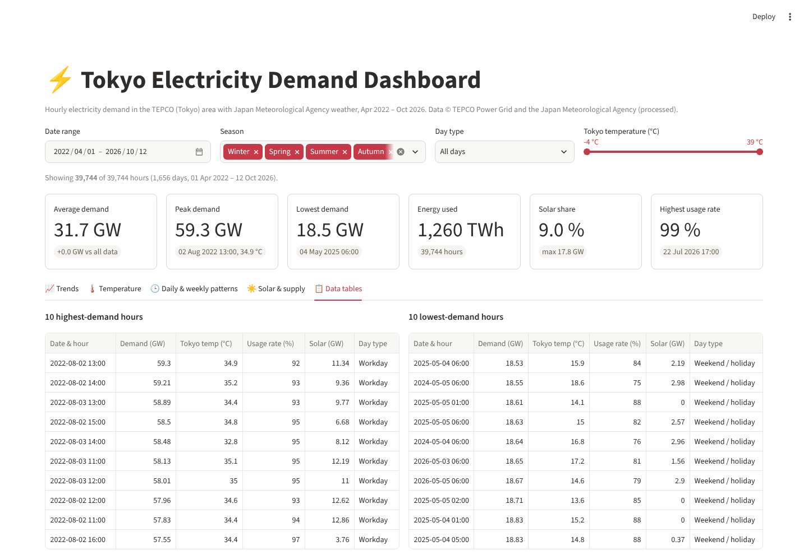

# ⚡ Tokyo Electricity Demand Dashboard

An interactive dashboard built with **Streamlit** and **Plotly**. It presents electricity demand in the Tokyo area together with Japanese weather data.

**Data:** `tokyo_hourly_clean.csv.gz` contains 39,744 hourly records from 1 Apr 2022 to 12 Oct 2026 (JST).
- **TEPCO Power Grid "でんき予報":** demand, TEPCO's forecast, supply capacity, usage rate and solar output (GW).
- **Japan Meteorological Agency (気象庁):** hourly temperature, humidity and sunshine at the Tokyo station.

Data © TEPCO Power Grid and the Japan Meteorological Agency (processed). It was compiled through [kaseee/tokyo-grid-lab](https://github.com/kaseee/tokyo-grid-lab).



## What the dashboard includes

| Requirement | What's in the dashboard |
|---|---|
| **Filters** | Date range, season (multi-select), day type (all days / workdays / weekends and holidays) and a Tokyo temperature range. Every metric, chart and table updates instantly. |
| **Key metrics** | Average demand (compared with the full dataset), peak demand with its date, time and temperature, lowest demand, energy used (TWh), solar share and the highest usage rate. |
| **Charts** (all interactive, with hover tooltips and zoom) | Monthly trend line · bar chart by month · scatter of daily peak vs temperature · demand by temperature band · daily profile by season · bar chart by weekday · hour × month heatmap · solar vs net demand · histogram of usage rates · TEPCO forecast error by season |
| **Data tables** | 10 highest and 10 lowest demand hours, a year-by-year summary, a monthly summary and a **CSV download** of the filtered data |
| **Important trends** | The Trends tab (monthly and yearly changes), an insight box that updates with the filters, and a "Key findings" panel |

The dashboard is organized into 5 tabs: **Trends · Temperature · Daily & weekly patterns · Solar & supply · Data tables**.

| Temperature | Daily & weekly patterns |
|---|---|
|  |  |
| **Solar & supply** | **Data tables** |
|  |  |

## Key findings
- **Summer sets the record:** demand peaked at **59.3 GW** at 13:00 on 2 Aug 2022, with Tokyo at 34.9 °C.
- **Temperature has a U-shaped effect:** demand is lowest at about **16–18 °C** and rises with both cold and heat, reaching about 50 GW on average at 34–36 °C.
- **The calendar matters:** workdays average about 4 GW more than weekends and holidays, and the lowest hours of all fall during Golden Week.
- **Peak hours shift with the season:** summer peaks in the early afternoon, while winter has morning and evening peaks.
- **Solar reshapes the day:** at noon, solar covers about 28 % of demand across the whole year, so the demand left for other power plants is lowest at midday.
- **Supply can get tight:** the highest usage was **99 %** of supply capacity, at 17:00 on 22 Jul 2026.

## Files

All files are in one folder.

| File | Contents |
|---|---|
| `app.py` | The dashboard (Streamlit + Plotly) |
| `tokyo_hourly_clean.csv.gz` | The data (pandas reads the `.gz` file directly) |
| `requirements.txt` | Python packages |
| `screenshot_*.png` | Screenshots for this README |

## How to run

```bash
pip install -r requirements.txt
streamlit run app.py
```

The dashboard then opens in your browser at http://localhost:8501.
